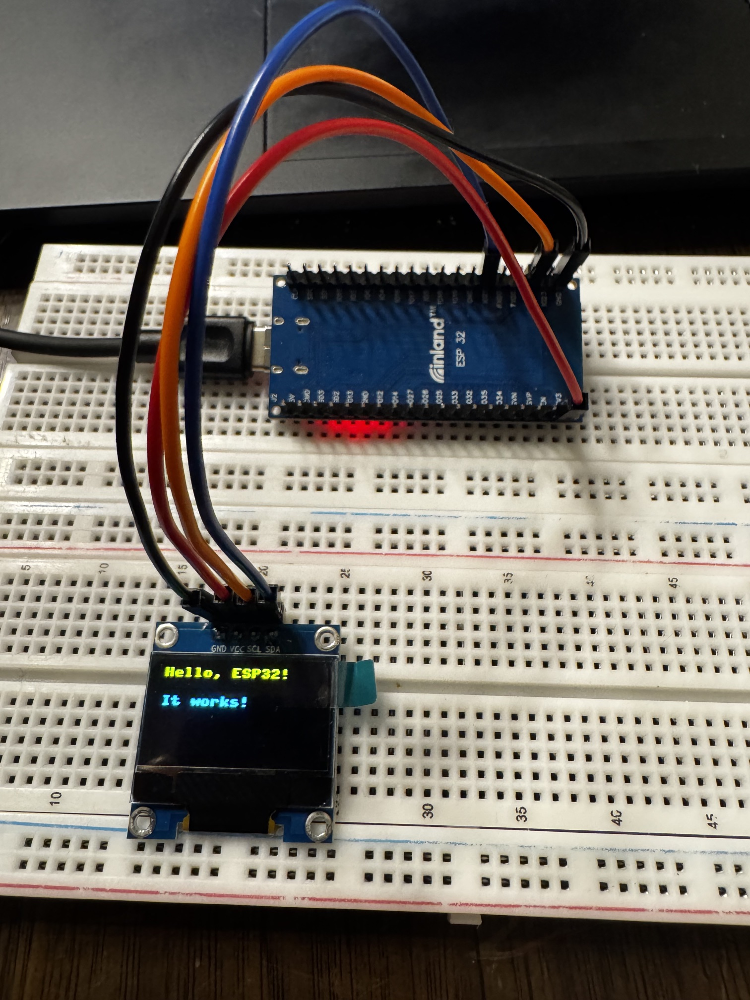
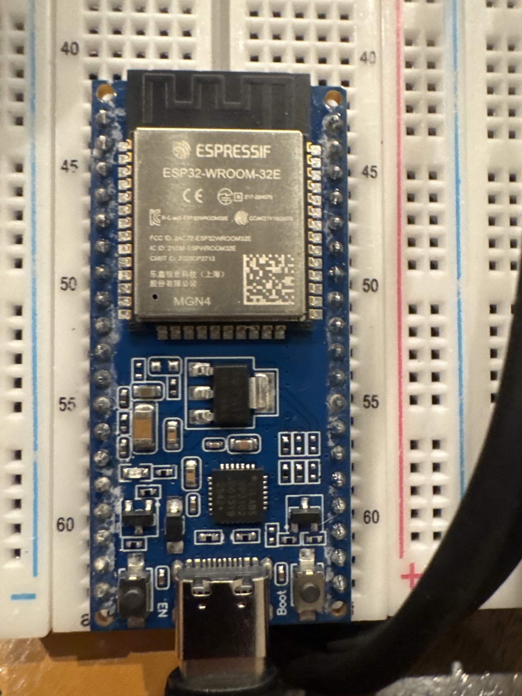
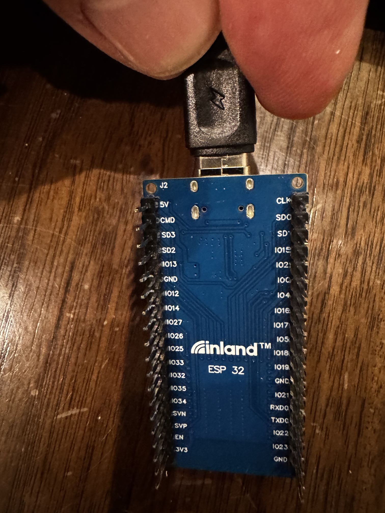
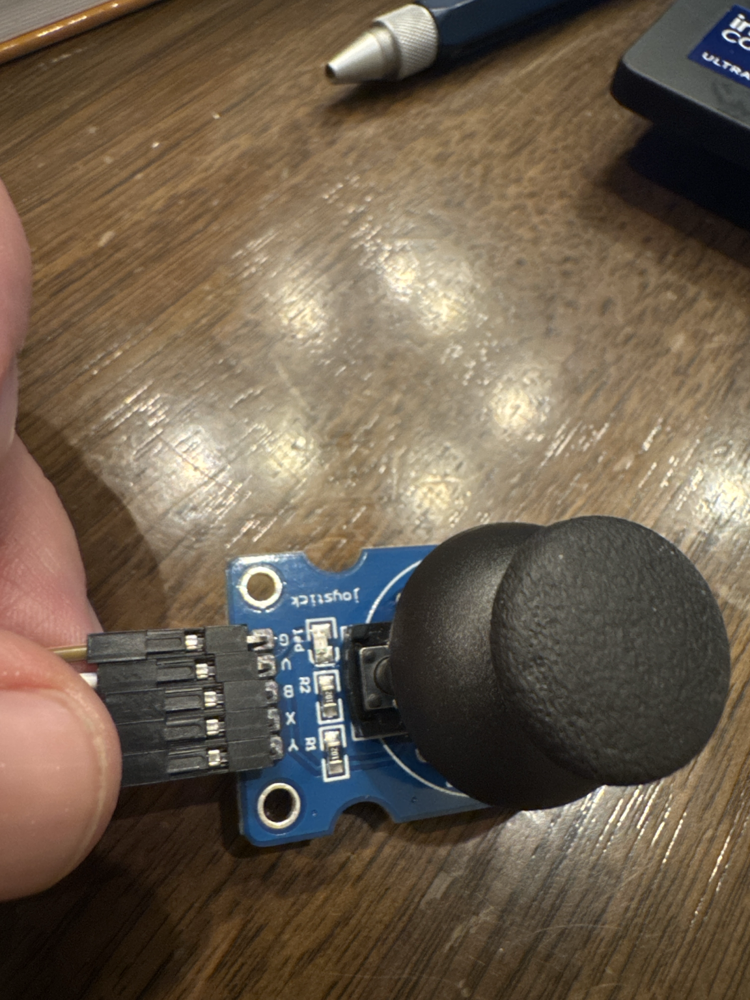
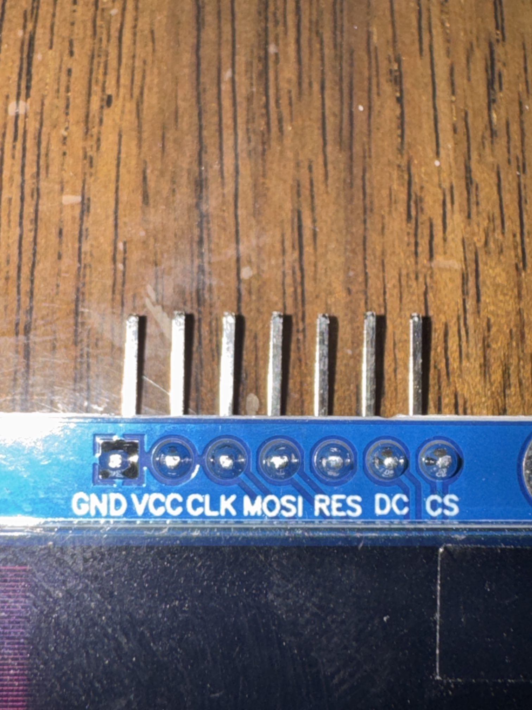

# ESP32 OLED + Joystick

A small MicroPython project: an ESP32 drives a 0.96" I²C OLED and reads an
analog joystick to move a dot around the screen. Button press shows a label.

## Demo

https://github.com/ducttaperobotics/esp32pong/pictures/IMG_1169.mp4

<!-- The line above renders as an inline video player on GitHub once USER/REPO
     is replaced with your actual repo path. Alternatively, drag the .mp4 into
     the GitHub web editor and it will insert a user-images URL that also
     autoplays-on-click. A local <video> tag is included below as a fallback. -->

<video src="pictures/IMG_1169.mp4" controls muted playsinline width="480"></video>



## Hardware

- **Inland ESP32** dev board (ESP32-WROOM-32E)
- **UCTRONICS UCT-602602** 0.96" 128×64 OLED, SSD1306 driver, I²C ("yellow blue" panel — top 16px row is yellow, rest blue)
- **Analog joystick** module (2 axes + pushbutton), header order `GND · +5V · B · X · Y`
- Breadboard + jumper wires

| ESP32 (front) | ESP32 (back, pin labels) | Joystick |
|---|---|---|
|  |  |  |

The pin labels are on the **back** of the board (`esp32-board-back.jpeg`) —
read those, not the physical position, when wiring.

> Note: the build started with a 1.3" SPI OLED (SH1106) that never came up.
> Switching to the 0.96" I²C SSD1306 was the fix — fewer wires, and I²C can
> be probed with `i2c.scan()` to confirm the device is detected. The abandoned
> SPI screen's header is shown below (`spi-screen-connectors.jpeg`).
>
> 

## Wiring

Power both peripherals from the breadboard rails: run one wire from ESP32
`GND` to the (–) rail and one from `3V3` to the (+) rail.

### OLED → ESP32 (I²C)

| OLED | ESP32 |
|------|-------|
| GND  | GND   |
| VCC  | 3V3   |
| SCL  | IO22  |
| SDA  | IO21  |

### Joystick → ESP32

| Joystick | ESP32 | Notes |
|----------|-------|-------|
| GND  | GND  | |
| +5V  | 3V3  | 3.3V keeps the ADC range matched |
| B    | IO25 | button, `INPUT_PULLUP` (pressed = 0) |
| X    | IO32 | ADC1 |
| Y    | IO33 | ADC1 |

**Why these pins:** the joystick axes are analog and must use **ADC1**
(GPIO 32–39), because the ESP32's ADC2 is unavailable when Wi-Fi is active.
IO32/IO33 avoid that and don't collide with the I²C pins.

## Firmware setup

1. Flash MicroPython (ESP32_GENERIC) to the board.
2. Copy `ssd1306.py` to the **device** (newer MicroPython builds no longer
   bundle it). Thonny: Files panel → save to MicroPython device.
3. Copy `main.py` to the device.

### Confirm the display is on the bus

```python
from machine import Pin, I2C
i2c = I2C(0, scl=Pin(22), sda=Pin(21))
print(i2c.scan())   # expect [60]  (0x3C)
```

`[60]` means the SSD1306 is detected and wired correctly. `[]` means a
wiring problem — check SDA/SCL (easy to swap) and power.

## main.py

```python
from machine import Pin, I2C, ADC
import ssd1306
import time

# --- Screen (I2C) ---
i2c = I2C(0, scl=Pin(22), sda=Pin(21))
oled = ssd1306.SSD1306_I2C(128, 64, i2c)

# --- Joystick ---
xaxis = ADC(Pin(32)); xaxis.atten(ADC.ATTN_11DB)   # 0-3.3V range
yaxis = ADC(Pin(33)); yaxis.atten(ADC.ATTN_11DB)
button = Pin(25, Pin.IN, Pin.PULL_UP)              # pressed = 0

px, py = 64, 32   # dot starts centered

while True:
    x = xaxis.read()   # 0..4095
    y = yaxis.read()

    if x > 3000: px -= 2        # X axis inverted on this stick
    elif x < 1000: px += 2
    if y > 3000: py += 2
    elif y < 1000: py -= 2

    px = max(0, min(127, px))
    py = max(0, min(63, py))

    oled.fill(0)
    oled.fill_rect(px - 1, py - 1, 3, 3, 1)   # 3x3 dot
    if button.value() == 0:
        oled.text("PRESS", 44, 0)
    oled.show()
    time.sleep(0.02)
```

## Tuning

- **Axis moves the wrong way** — swap `>` and `<` for that axis (done here
  for X), or swap the X/Y wires.
- **Dot drifts when the stick is centered** — the stick's center isn't
  exactly 2048; widen the dead zone (e.g. `> 3200` / `< 900`).
- **Pick thresholds empirically** — add `print(x, y, button.value())` to the
  loop and watch the REPL while moving the stick.

## Troubleshooting notes

- `i2c.scan()` returning `[60]` is the single most useful check — it proves
  power + both data lines before any driver code runs.
- Measure VCC→GND at the display's own pins (~3.3V) to rule out power.
- A dead/blank screen with no error is almost always a wire, not the driver.
